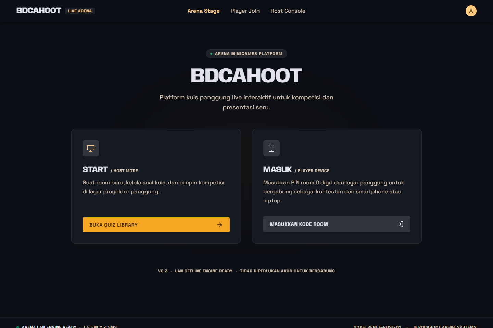
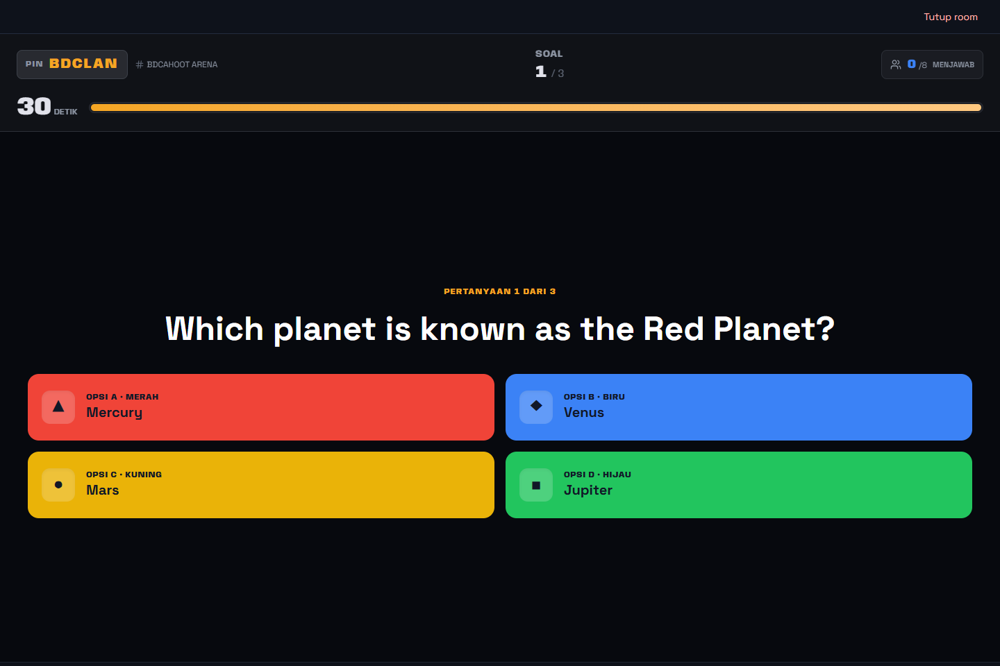
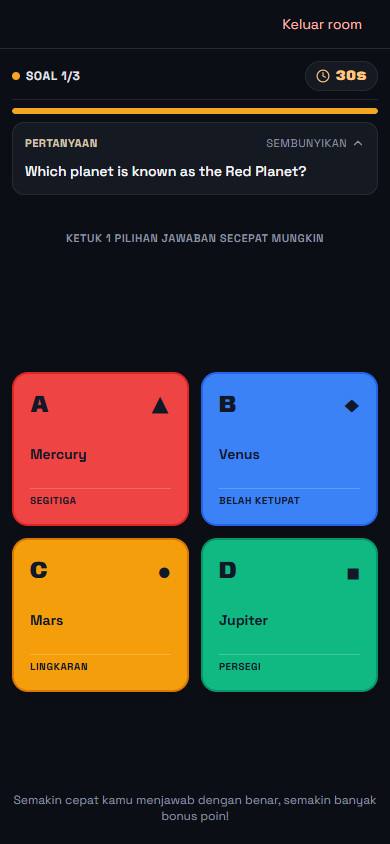

<div align="center">

# BDCAHOOT Live

**A live quiz arena for the room you're in.**

Create a quiz, share a room code, and let everyone play from their phone.

Next.js 15 · React 19 · TypeScript · Socket.io · SQLite · Tailwind CSS

[Quick start](#quick-start) · [How it plays](#how-it-plays) · [Screenshots](#screenshots) · [Testing](#testing) · [Operator guide](docs/OPERATIONS.md)

</div>



BDCAHOOT Live is a self-hosted multiplayer quiz app for events, classrooms, and game nights on a local network. A laptop runs the server and host screen; participants join through a browser on the same Wi-Fi. The operator controls the pace between questions and decides when to reveal the final podium.

**First live event: 67 participants, 20 questions.** The project owner reported a complete session with no observed errors or freezes. Automated load tests are documented separately below.

## What you can do

- Create and edit quizzes with four answer options, per-question timers, and automatic saving to a local SQLite database.
- Invite players with a six-character room code. Players choose a nickname and one of 12 robot avatars.
- Start with a synchronized five-second countdown, then collect answers against a server-controlled deadline.
- Reveal the correct answer, show animated rankings between rounds, and advance when the operator is ready.
- Keep the final scoreboard off-screen until the operator opens the podium, which reveals third, second, then first place.
- Recover browser sessions after refresh or reconnect, without duplicating accepted answers or points.
- Browse completed matches in the operator's **Riwayat Pertandingan**, inspect every participant's ranking, and download CSV results from history or the final podium. Replaying a quiz creates a separate match record.

Fonts and avatars are served locally. After installation and the production build, gameplay does not need an internet connection. The application interface is currently in Indonesian; this README is in English.

## Quick start

Use **Node.js 22.22.2+ within v22, 24.15.0+ within v24, or v26+**, and npm. Run these commands from the project folder:

```sh
npm ci
npm run build
npm start
```

The server prints its local URL, LAN URL, operator key, and database path. SQLite initializes automatically; no separate database server or SQL setup is needed.

| Who | Where to go | What to do |
| --- | --- | --- |
| Operator | `http://localhost:3000/host/library` on the server laptop | Enter the operator key from the terminal, create a quiz, then choose **Mulai Room**. |
| Players | The printed LAN URL followed by `/player/join` | Enter the room code once, choose a name and avatar, then join the lobby. |
| Operator | The room screen | Wait for the participants, then press **Mulai Game**. |

For example, if the terminal prints `http://192.168.1.10:3000`, players open `http://192.168.1.10:3000/player/join`. Their devices must be able to reach the server laptop on the network; `localhost` on a phone refers to the phone itself.

**Share the room code with players. Keep the operator key private.** Use `npm start`, which runs the combined Next.js and Socket.io server. For development, use `npm run dev`.

If a local environment file sets `NODE_ENV=development`, remove that override or set it to `production` before building and running an event. See the [configuration and operator guide](docs/OPERATIONS.md) for environment variables, backups, and recovery.

## How it plays

| Step | On screen | Who advances it? |
| --- | --- | --- |
| 1 | Room code and player lobby | Operator starts the game. |
| 2 | **5 → 4 → 3 → 2 → 1** | The server opens the first question. |
| 3 | Question, answer buttons, and timer | The server closes the round after the deadline and 200 ms grace period; the host can also reveal early. |
| 4 | Correct answer and a short preview countdown | Automatically continues after 3–5 seconds. |
| 5 | Scoreboard between questions | Operator presses **Lanjut** for the next question. |
| 6 | After the last preview: **Lihat Podium Juara** | Operator chooses when to open the podium. There is no final scoreboard on this waiting screen. |
| 7 | Third → second → first place | Five seconds between podium reveals; reduced-motion settings show all places immediately. |

Scores use server-measured response time. Ties resolve by total points, then total response time, then join order. Retrying an accepted answer returns its existing receipt instead of awarding points again. Network latency still affects when the server receives an answer.

## Screenshots

These are actual captures from a local production build using a temporary demo quiz and fictional participants. They are not photographs of the live event. The room shown is not an active public room.

**Host screen** · The shared question, timer, and answer count.



<details>
<summary><strong>Player screen</strong> · View the phone layout</summary>

<p align="center">
  
</p>

Players answer on their own device. The server confirms accepted submissions, and the player can leave the room through the on-screen control.

</details>

## Built for a local event

| Part | Responsibility |
| --- | --- |
| Next.js + React | Host console, quiz editor, player screens, and responsive layouts. |
| Socket.io + Node.js | Live room state, authenticated host actions, answer receipts, and reconnects on the same port as the web app. |
| Game engine | Authoritative deadlines, scoring, deterministic rankings, and stage transitions. |
| SQLite worker | Saved quizzes and match snapshots; successful mutation ACKs wait for persistence. |
| Tailwind CSS + Motion | Styling, ranking transitions, and podium animations. |

Quiz content lives in **`data/game.sqlite`** by default. Changing Wi-Fi or the server's IP address does not erase saved quizzes when you use the same database. Browser session recovery is separate and depends on the browser profile and origin.

Completed results are archived in the same database when the last question closes, before the podium is opened. Closing the room or editing/deleting its quiz does not remove the archive. History applies to rooms created with this feature; cancelled or partially played matches are not archived. See the [results and upgrade notes](docs/OPERATIONS.md#match-history-and-csv-results).

The intended event size is **50–100+ players**. Configured limits are 150 players per room, 200 questions per quiz, 200 KiB per quiz payload, 500 saved quizzes, and 16 active rooms. These are application limits, not a promise of Wi-Fi capacity.

Keep the server laptop awake and the terminal running during a game. Use a trusted LAN, allow the server through the private-network firewall, and check that guest/client isolation does not block participants. Rooms expire after six hours without authenticated activity; merely leaving a tab open is not an unlimited keep-alive.

HTTP is the current LAN setup. It does not encrypt session tokens in transit. Do not expose this server directly to the internet or share the database, which contains answer keys and session secrets. See [Security boundaries](SECURITY.md).

## Testing

```sh
npm test
npm run typecheck
npm run lint
npm run build
```

| Evidence | Scope |
| --- | --- |
| First event: 67 participants × 20 questions | Owner-reported real-world session; no observed errors or freezes. |
| 63 regression tests passed in the 11 October 2026 audit | Engine, transport, persistence, recovery, and podium fault cases. This is a dated result, not a live CI badge. |
| 100 Socket.io clients × 40 questions | Real socket connections and 4,000 submissions with accelerated question time on localhost. |
| 80 participants × 40 questions in a recorded endurance pass | 70 socket bots + 10 full browser players, production server, SQLite, and real question timers on one machine. |

Local simulations do not reproduce dozens of physical phones, Wi-Fi interference, or every browser background behavior. The [testing guide](docs/TESTING.md) includes repeatable commands, measurement limits, and links to audit reports that also record failed attempts.

## Project map

```text
app/            Next.js routes and local fonts
components/     Host, player, and shared interface components
context/        Client connection and session recovery
server/         Game engine, Socket.io server, SQLite worker
lib/            Scoring, validation, quiz storage, and audio
types/          Game and network contracts
tests/          Automated regression tests
scripts/        Browser checks and endurance harnesses
public/avatars/ Locally served robot illustrations
docs/           Operations, testing notes, and screenshots
```

## Documentation

- [Operator guide](docs/OPERATIONS.md): startup, saved quizzes, backups, and what to do after a disconnect or restart.
- [Testing guide](docs/TESTING.md): browser checks, endurance commands, and how to interpret the results.
- [Match history verification](docs/match-history-verification-2026-11-16.md): archival, CSV, database migration, and regression evidence for the results feature.
- [Podium audit](docs/podium-audit-2026-10-11.md): final-question flow, lost ACK handling, and known disclosure limits.
- [Verification history](docs/verification.md): dated implementation and test records; newer entries supersede earlier behavior.

Robot illustrations are Bottts by Pablo Stanley, distributed via DiceBear; see [asset attribution](public/avatars/README.txt). Bundled fonts include their licenses: [Anybody](app/fonts/Anybody-OFL.txt) and [Space Grotesk](app/fonts/SpaceGrotesk-OFL.txt).
